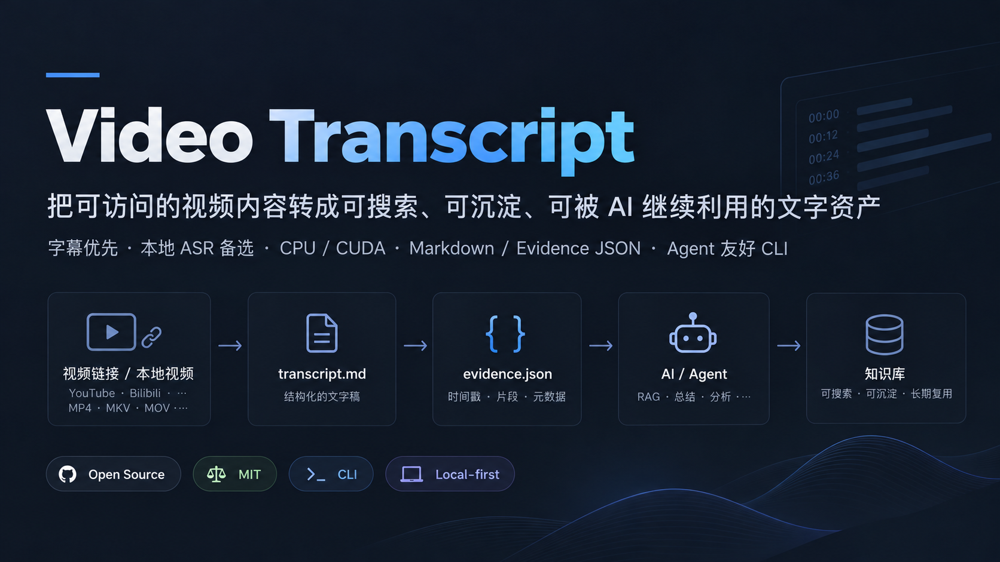
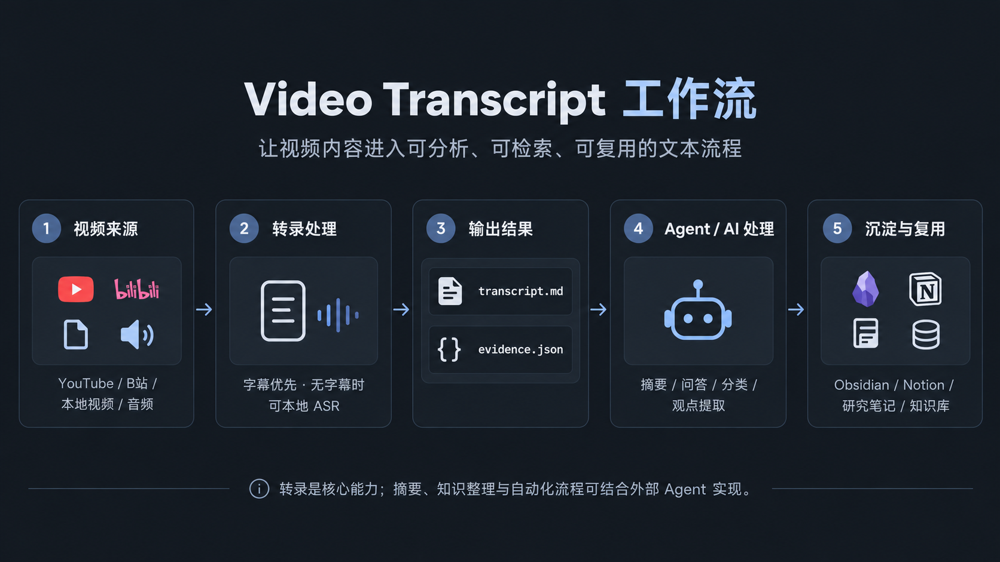

# 视频转录 | Video Transcript

**Video Transcript · v0.3.2 Beta 发布候选 · 中文说明**<br>
[English](README.en.md) · [在线平台实测矩阵](docs/online-support-matrix.md)

> 本文按 v0.3.2 Beta 候选整理。下方安装命令指向 v0.3.2 目标 Release 的 wheel 和校验文件；只有该版本 Release 发布并上传附件后才能下载。已公开的 [v0.3.0 Pre-release](https://github.com/CHAOSEA/video-transcript/releases/tag/v0.3.0) 是历史版本，不包含本文介绍的 Doctor、模型推荐和 CUDA 支持。

Video Transcript 把已支持平台的视频链接或本地音视频，变成带时间轴的逐字稿。没有可用字幕时，只要平台允许获取媒体，工具就会在本机识别语音；在 Codex 中还可以按需基于逐字稿生成单独的分析稿。

命令行会生成 `transcript.md` 和 `evidence.json`，后者记录原始分段、来源和运行参数。分析稿由 Codex 项目 Skill 按你的要求另存为 `analysis.md`，不覆盖逐字稿；单独使用命令行时不会生成分析稿。



> Beta 已经过多轮真实平台样本检查和自动化回归。公开支持范围按平台与处理路径披露，不代表所有视频都能处理成功。

## 项目是什么？怎么使用？

核心产品是独立运行的 Python 命令行工具（CLI）；本仓库同时提供 Codex 项目级 Skill，帮助 Agent 调用 CLI 并检查结果。字幕获取、媒体处理和 ASR 始终由 CLI 执行。

### 推荐方式：Codex + 项目 Skill

1. 在 Codex 中打开本仓库根目录。
2. 按下方安装说明安装 CLI；只取字幕不需要模型，只有准备运行 ASR 时才选择并准备本地 Whisper 模型。
3. 直接提出转录需求，或显式调用较短的 Skill 名 `$video-transcript`，例如：“用 `$video-transcript` 转录这个链接，中文，输出到 D:\transcripts\run-01。”

Skill 位于 [.codex/skills/video-transcript/SKILL.md](.codex/skills/video-transcript/SKILL.md)。它会选择在线链接、纯字幕或本地媒体入口，并检查 CLI 输出。若要求分析稿，Codex 可另存独立的 `analysis.md`。若这需要把私人逐字稿交给云端模型，Agent 必须先说明并取得用户明确授权；单纯要求分析不等于授权上传。分析稿和原稿分开保存。

### 也可以独立使用

不需要 Codex、WorkBuddy 或云端 AI 服务。安装并激活项目环境后，在 PowerShell 运行：

~~~powershell
video-transcript-link "https://www.youtube.com/watch?v=VIDEO_ID" --language zh --model small --output-dir "D:\transcripts\run-01"
~~~

本地文件使用 video-transcript；只获取在线字幕时使用 video-transcript-online。

### 在 Codex、WorkBuddy 和其他 AI Agent 中使用

Video Transcript Workbench 提供标准命令行接口，不绑定某一个 AI Agent。Codex、WorkBuddy 和其他获准使用终端与文件的 Agent，都可以用相同的 CLI 命令处理媒体；调用已安装的 CLI 不需要专用 Skill。仓库附带的 Codex 项目 Skill 只负责帮助 Codex 选择命令并核对结果，不是转录引擎，也不是使用 CLI 的前提。项目目前没有 WorkBuddy 原生 Skill 或连接器。

运行命令的环境必须能访问已安装的 CLI、Python 依赖、已准备的本地模型和要处理的媒体。云端 Agent 或另一台电脑不会自动获得你这台电脑上的终端、文件或模型访问权限；需要有授权的远程执行环境才能使用这些资源。在线链接用 `video-transcript-link`，本地音视频用 `video-transcript`，只获取在线字幕用 `video-transcript-online`。模型需由用户明确准备；ASR 加载本机模型并在执行 CLI 的计算机上运行。

#### 通用 Agent 调用流程（Windows PowerShell）

下面的环境诊断与模型引导命令适用于 v0.3.2 CLI；已公开的 v0.3.0 wheel 不含这些命令。Agent 可在实际运行 CLI 的 Python 环境中用 `python -m pip show video-transcript-workbench` 确认安装版本，再使用该版本实际提供的命令。

```powershell
# 确认命令可用，并检查本机模型与计算设备
Get-Command video-transcript, video-transcript-link, video-transcript-online
video-transcript doctor --json | ConvertFrom-Json

# 查看模型状态；Doctor、list 和 recommend 均不会下载
video-transcript models list
video-transcript models recommend --intent quality --device auto
# 仅当你已选择模型并决定下载时运行：
# video-transcript models prepare small

# 本地媒体：与在线链接命令二选一
video-transcript "D:\media\sample.mp4" --model small --device auto --language zh --output-dir "D:\transcripts\run-01"

# 在线链接：与本地媒体命令二选一
# 字幕优先尝试可省略模型；无字幕时会在媒体下载前提示 model_required
# video-transcript-link "https://www.youtube.com/watch?v=VIDEO_ID" --language zh --output-dir "D:\transcripts\run-01"
```

命令结束后先检查退出码和 `evidence.json` 的 `status`，再按用户授权读取输出目录中的 `transcript.md` 与 Evidence。`success` 表示流程有可用文字，不等于准确率已验证；`uncertain` 表示检测到启发式质量信号。查看 `quality.review_scope`：若为 `segments`，先复核 `affected_segment_indices` 指出的片段，其他片段不会因此自动判错；若为 `run`，复核范围是整次结果。该状态不是准确率或置信度评分。`no_speech_detected` 是检测结果，不证明音频绝对没有讲话；`failed` 表示处理失败。不要只凭命令退出成功或文件存在，就断言逐字稿准确。

ASR 推理在运行 CLI 的计算机上完成。若 Agent 要读取私人逐字稿并交给云端模型分析，必须先说明文本会发送到云端并取得用户明确授权；用户只要求生成分析稿，不等于授权上传。未获授权时不要读取或发送文本，可改用本地模型或询问授权。需要本地处理时，可只运行 CLI 并在本机查看输出。

## 处理流程



流程简述：

1. 输入 YouTube、Bilibili、抖音或小红书视频链接，或选择本地媒体文件。
2. 在线链接先查找匹配语言的人工字幕，再尝试自动字幕。
3. 没有可用字幕时，只有在平台正常允许访问的情况下，才获取音轨或带音轨 MP4，并在本机运行 faster-whisper；默认自动选择可用的 CUDA 或 CPU/int8。
4. CLI 输出时间轴逐字稿 `transcript.md` 和原始分段、来源及运行参数 `evidence.json`。
5. 用户提出分析需求时，Codex 可基于逐字稿另存 `analysis.md`，不覆盖转录文件。

字幕内容与 ASR 原始识别文本都会保留；格式化不会覆盖原始分段。工具不调用云端转录服务，不读取浏览器 Cookie，也不绕过登录、真人验证或地区限制。

## 输出效果示意


图中逐字稿、JSON 和分析稿均为**虚构格式示例**。`analysis.md` 不是 CLI 自动输出；Codex 只有在用户提出分析需求时才会生成。示例不代表识别准确率。

## 在线平台实测状态


| 平台与路径 | 实测状态 | 说明 |
|---|---|---|
| YouTube 人工字幕 | PASS | 已真实获取字幕；特定字幕格式失败时验证过备用字幕格式。 |
| YouTube 自动字幕 | PASS | 已真实获取自动字幕，证据中保留其自动生成属性。 |
| YouTube 无字幕 → 本地 ASR | PASS（样本级；媒体请求可能间歇失败） | 稳定版和 nightly 都完成过真实无字幕音轨下载及 CPU ASR。音轨遇到 HTTP 403 时，程序现在会额外尝试一次平台提供的 HTTPS 合并 MP4（仅在该格式可用时）；nightly 上用注入的首选音轨 403 验证了 MP4 → 解码 → ASR 全链路。稳定版对同一视频未提供合并格式，不能保证这条回退总可用。测试样本对白不足，不用于准确率判断。 |
| Bilibili 无字幕音轨 → 本地 ASR | PASS | 已完成真实音轨下载和 CPU 转录。 |
| Bilibili 字幕获取 | 未验证 | 尚无真实字幕成功样本。 |
| 小红书 HTTPS MP4 → 本地 ASR | PASS（单样本） | 一条公开视频完成真实下载与本地转录；不代表其他视频都能访问。 |
| 小红书字幕获取 | 未验证 | 尚无成功解析真实字幕轨道的样本。 |
| 抖音在线转录 | 受限 | yt-dlp 稳定版和官方 nightly 对公开样本都在元信息前返回 fresh-cookie 访问挑战；未下载媒体，也未尝试获取或伪造凭据。 |

### 实测覆盖范围

- YouTube：此前的公开视频样本中，2 条人工字幕和 1 条自动字幕路径成功。2026-10-20 稳定版和 nightly 都完成过无字幕音轨 → CPU ASR；稳定版另有两次媒体请求返回 HTTP 403。新增的 HTTPS 合并 MP4 回退经过一次真实下载、解码和 ASR 验证；首选音轨的 403 由本地测试注入，不能写成平台自然复现。稳定版对该样本没有提供合并 MP4 格式。该动画样本缺少可用对白，模型输出出现大量重复内容，因此这些运行只证明链路，不证明识别质量。
- Bilibili：R0 检查 6 个公开视频，R1 又检查 3 个公开页面的元信息和字幕轨；1 条无字幕音轨完成本机 ASR，尚无真实字幕成功样本。
- 小红书：经过多轮链接、网络和 HTTPS 媒体诊断，1 条公开视频完成 MP4 到本机 ASR 的端到端流程。
- 抖音：一个无凭据公开样本分别用 yt-dlp 2026.8.19 和官方 nightly 2026.10.10.233141 检查，均在视频元信息前遇到 fresh-cookie 挑战；这不能证明必须登录，在线转录仍未通过。
- 自动化回归测试另行统计，包含离线和合成案例，不等于真实视频样本数。v0.3.0 发布验收时的 86 项测试是历史记录。

详细样本覆盖、状态定义和用户可见限制见[在线平台实测矩阵](docs/online-support-matrix.md)。公开视频检查数量、成功路径数量和自动化回归数量分别披露。首轮 30 条 FLEURS 普通话朗读样本中，small 与 large-v3 的加权 CER 分别为 16.78% 和 7.89%；该结果只描述这组朗读语音与本机 CUDA/float16 条件，不能代表访谈、多人讨论或所有中文视频。方法、限制和来源见[准确率评测说明](docs/accuracy-evaluation.md)。

## 命令

安装后提供三个入口：

- `video-transcript-link`：在线链接，字幕优先；符合条件时回退到本地 CPU 或 CUDA ASR。
- `video-transcript-online`：只获取在线字幕，不下载媒体、不运行 ASR。
- `video-transcript`：转录本地 WAV、MP3、M4A、MP4、WebM、Ogg 或 Opus 文件；也提供 `models` 子命令管理本地模型。
- v0.3.2 还提供 `video-transcript doctor [--json]` 与 `video-transcript models recommend`，用于环境诊断和模型选择引导。

## Windows 安装（无需 Git）

### v0.3.2 Beta（GitHub Release 发布后）

不需要 Git、GitHub CLI、Codex 或 WorkBuddy。以下版本化下载地址在 v0.3.2 Release 发布并附上 wheel 与 `SHA256SUMS.txt` 后生效；发布前地址不可用。Python 3.11 是已验证的安装环境。项目本身不发布到 PyPI。

~~~powershell
$installRoot = Join-Path $env:USERPROFILE "video-transcript-v0.3.2"
New-Item -ItemType Directory -Force -Path $installRoot | Out-Null
Set-Location $installRoot

$wheelName = "video_transcript_workbench-0.3.2-py3-none-any.whl"
$release = "https://github.com/CHAOSEA/video-transcript/releases/download/v0.3.2"
Invoke-WebRequest "$release/$wheelName" -OutFile $wheelName
Invoke-WebRequest "$release/SHA256SUMS.txt" -OutFile "SHA256SUMS.txt"
$sumLine = Get-Content .\SHA256SUMS.txt | Where-Object { $_ -match [regex]::Escape($wheelName) } | Select-Object -First 1
if (-not $sumLine) { throw "Release checksum for $wheelName was not found." }
$expected = ($sumLine.Trim() -split "\s+")[0]
$actual = (Get-FileHash -Algorithm SHA256 $wheelName).Hash
if ($actual -ne $expected) { throw "Wheel SHA256 does not match the published checksum." }

py -3.11 -m venv .venv
$venvRoot = (Resolve-Path .\.venv).Path
$python = Join-Path $venvRoot "Scripts\python.exe"
& $python -m pip install ".\$wheelName"
& $python -m pip check
$venvScripts = Join-Path $venvRoot "Scripts"
$env:PATH = "$venvScripts;$env:PATH"
$cli = Join-Path $venvScripts "video-transcript.exe"
$linkCli = Join-Path $venvScripts "video-transcript-link.exe"
$onlineCli = Join-Path $venvScripts "video-transcript-online.exe"
& $cli --help
& $linkCli --help
& $onlineCli --help
& $cli doctor
~~~

安装后可激活 `.venv`，或像上面的示例一样仅将 `.venv\Scripts` 加入当前 PowerShell 进程的 PATH，再运行 `video-transcript doctor`。v0.3.0 是保留的历史 Pre-release，仍可从 [GitHub Releases](https://github.com/CHAOSEA/video-transcript/releases) 查看；它不包含 v0.3.2 的新手诊断、模型管理和 CUDA 功能。

### 准备模型，再开始转录

字幕获取不需要 Whisper 模型。若要执行本地 ASR，先查看候选与缓存状态；模型准备会联网下载，只在你选定模型并确认后运行：

~~~powershell
$venvScripts = (Resolve-Path .\.venv\Scripts).Path
$env:PATH = "$venvScripts;$env:PATH"
$cli = Join-Path $venvScripts "video-transcript.exe"
& $cli doctor
& $cli models list
& $cli models recommend --intent quality --device auto
# 选择模型并决定下载后，再运行以下命令：
& $cli models prepare small
& $cli models verify small

# 本地媒体：auto 尝试 CUDA，必要时以同一模型回退 CPU/int8
& $cli "D:\media\sample.wav" --model small --device auto --language zh --output-dir "D:\transcripts\run-01"

# 在线链接：可以省略 --model 尝试字幕；没有可用字幕时需选定模型后重试
& (Join-Path $venvScripts "video-transcript-link.exe") "https://www.youtube.com/watch?v=VIDEO_ID" --language zh --output-dir "D:\transcripts\run-02"
~~~

模型权重保存在本机缓存，不属于项目 wheel，并遵循各自的许可和使用条款。工具不会自动下载模型、偷偷换模型或因检测到 GPU 而替用户选择更大的模型。`--device auto` 只选择计算设备；CUDA 初始化或推理失败时，程序使用同一个模型回退 CPU/int8。若需强制使用 GPU，可传 `--device cuda`；显式 CUDA 失败会报错而不回退。

部分在线视频 JavaScript challenge 路径需要 Node.js。建议使用受支持的 Node 24 LTS；Node 25 已结束支持。项目不安装 Node.js。Node 缺失或版本不受支持只影响部分在线提取路径，不影响本地转录。

### v0.3.2 Beta 功能与模型选择

v0.3.2 提供离线 `video-transcript doctor`、`video-transcript doctor --json`、`video-transcript models recommend --intent {resources,speed,quality,cached}`，并支持 `--device auto|cpu|cuda`。这些命令不在 v0.3.0 历史 wheel 中。

`doctor --json` 可供 Codex、WorkBuddy 或其他获准访问终端的 Agent 读取；结果按能力分别报告，不包含模型绝对路径、token 或环境变量值。它只探测 CTranslate2 的 CUDA 能力，不会加载模型；CPU int8 就绪时，没有 NVIDIA GPU 仍可显示本地 ASR `ready`。Node 25 会显示为已结束支持并建议切换到 Node 24 LTS；Node/EJS 状态只影响部分在线视频 JavaScript challenge 路径。

模型引导只给候选与证据。FLEURS 30 条普通话朗读样本中 large-v3 的 CER 为 7.89%，small 为 16.78%；同一 CUDA/float16 评测中 large-v3 慢约 3.26 倍。这只能描述该语料，不能保证所有视频都更准确。Q0 单次 CPU 样本中 base 更快、进程峰值 RSS 较低，也不等于普遍的速度或内存保证。`recommend` 不自动下载、不设置全局默认，也不因发现 GPU 替用户改模型。

Windows CUDA 环境需要兼容的 NVIDIA 驱动、CUDA 12 cuBLAS 与 cuDNN 9。请参照 [faster-whisper 官方 GPU 安装说明](https://github.com/SYSTRAN/faster-whisper#gpu)，不要从不明网站下载 DLL。`models device` 和 Doctor 显示的是 CTranslate2 探测结果，不是所选模型的加载或推理验收；`--device auto` 运行时会尝试 CUDA，失败时用同一个模型回退 CPU/int8。

本机 RTX 3060 的一次同音频实测中，209.5 秒样本用 `small` CPU/int8 花了 49.1 秒，用 `small` CUDA/float16 花了 9.3 秒；`large-v3` CUDA/float16 花了 27.6 秒。这只是单机、单样本、单次运行的速度记录；没有人工参考稿，不能据此比较准确率，也不代表其他显卡的速度。

## 在线链接用法

### 字幕优先，必要时本地 ASR

~~~powershell
video-transcript-link "https://www.youtube.com/watch?v=VIDEO_ID" --language zh --model small --device auto --output-dir "D:\transcripts\video-run-01"
~~~

在 v0.3.2 中，如果只想先尝试字幕，可省略 `--model`；字幕成功时无需准备 Whisper 模型。若没有可用字幕，命令会在下载媒体前返回 `model_required`，提示显式选择模型，再带 `--model` 重试。v0.3.0 历史版本要求提供 `--model`。

支持 YouTube、Bilibili、抖音和小红书视频笔记 URL。字幕语言偏好为 `zh`、`en`、`ja`。小红书仅支持视频笔记，不支持纯图文笔记。

链接可识别不等于每个链接都能处理。访问权限、字幕轨道、地区、网络、媒体格式和本地资源都会影响结果；请先查看上面的样本级实测矩阵。

如果平台拒绝在线请求，但你已经通过平台允许的方式保存了本地视频或音频，可以直接用下面的 `video-transcript` 本地入口继续转录。在线入口不会读取浏览器登录态，也不会绕过访问检查。

如果系统代理环境变量指向不可用端口，可以用 `--proxy` 为当前命令指定代理，不会修改 Windows 的系统代理或环境变量：

~~~powershell
video-transcript-link "https://www.youtube.com/watch?v=VIDEO_ID" --language zh --model small --output-dir "D:\transcripts\video-run-01" --proxy "http://127.0.0.1:1080"
~~~

请把示例端口换成你本机正在运行的 HTTP(S) 代理端口。代理参数只在本次命令中生效；不支持在参数中填写代理用户名或密码。省略 `--proxy` 时仍按常规读取当前进程的代理环境变量。

### 只获取字幕

~~~powershell
video-transcript-online "https://www.youtube.com/watch?v=VIDEO_ID" --language en --output-dir "D:\transcripts\subtitle-run-01"
~~~

该命令只获取平台元信息和匹配字幕，不下载媒体，也不运行语音识别。如果系统代理失效，也可用 `--proxy "http://127.0.0.1:1080"` 为这次命令指定代理。

## 本地媒体用法

~~~powershell
video-transcript "D:\media\sample.mp4" --model small --device auto --language zh --output-dir "D:\transcripts\local-run-01"
~~~

媒体在本机解码和转录。`--device auto`（默认）先查询 CTranslate2 是否能使用 CUDA；可用时尝试 NVIDIA GPU，不可用或 CUDA 初始化/推理失败时使用同一个模型回退到 CPU/int8。可以用 `--device cpu` 固定 CPU，或用 `--device cuda` 要求 GPU（不可用时明确失败）。视频输入使用第一条音轨，源文件不会被修改。为避免误处理超长文件，本地输入默认限制为 30 分钟；可用 `--max-duration-seconds` 调整，最高 4 小时。模型必须是本地已有的模型路径或已缓存模型；缺失时会报错，不会静默下载或降级。

可显式加 `--vad-filter` 使用 faster-whisper 内置 Silero VAD，过滤部分静音并降低纯静音导致重复幻觉的风险。VAD 可能漏掉低音量或被噪声覆盖的讲话，因此目前默认关闭；Evidence 会区分“检测到语音”“未检测到语音”和“结果需复核”，并保留可疑原始分段，不自动删字。模型状态为 `uncertain` 时应先人工复核，不要把它当成准确逐字稿。

设备诊断和模型缓存检查：

~~~powershell
video-transcript models device
video-transcript models path small
~~~

模型必须显式选择，CPU/GPU 自动选择只改变计算设备，不改变模型。FLEURS 朗读样本的首轮对照中 large-v3 CER 较低，但大约慢 3.3 倍；这还不能决定真实访谈、混合音频或 CPU 用户的通用默认模型。项目暂不提供声称“均衡”或“高准确度”的自动模型档位；应按内容重要性选择并人工复核关键专名、数字和否定词。

## 结果与隐私

成功运行会生成：

- `transcript.md`：逐段时间轴与原始文字。
- `evidence.json`：视频标识或本地输入 SHA256、字幕/ASR 来源、原始分段、模型与设备参数、依赖版本及运行状态。

在线证据不会保存原始查询参数、签名字幕地址或签名媒体地址。小红书分享链接中显式提供的必要分享参数只在请求期间使用，不写入证据或安全错误。结果文件本身可能包含视频标题和完整逐字稿，请妥善保管输出目录。

工具不使用云端 ASR，不自动读取浏览器资料或 Cookie，不绕过访问验证。线上下载有时长和字节数限制，媒体使用临时目录并在流程结束后清理。较长的本地音频仍会占用较多内存。

## 已知限制

- 平台访问检查、网络或代理故障会作为独立失败状态报告，不会被伪装成“没有字幕”。
- 用户指定的模型不会自动降级；模型文件缺失会明确报错。
- 当前 FLEURS CER 对照使用数据集提供的普通话朗读参考文本，维护者未逐条听校；尚无基于人工校订参考稿的自然视频对白 CER 基准，因此不能据此决定通用默认模型。large-v3 在 FLEURS 样本上得分较低，不等于所有视频都更准确。
- 成功样本不保证其他视频、语言、地区或网络环境可以成功。
- 仅处理自己有权访问和处理的媒体，并遵循平台条款和内容权利要求。

准确率评测方法、FLEURS 首轮结果及限制见[本地准确率评测说明](docs/accuracy-evaluation.md)。私人参考音频、逐字稿和运行证据仍应留在本机，不要提交到仓库。

## 开发与测试

v0.3.2 RC 的 **162 项自动化回归测试**全部通过；v0.3.0 发布验收曾通过 86 项测试。测试包含合成媒体与字幕样例，不替代真实平台兼容性验证，也不代表真实视频数量。

~~~powershell
python -m unittest discover -s tests -v
~~~

Node.js 24 LTS / yt-dlp-ejs、完整依赖安装和发行包检查记录见[依赖与权利记录](DEPENDENCIES.md)。

## 许可证

项目源码采用 MIT 许可证，版权行：`Copyright (c) 2026 CHAOS`。完整许可见 [LICENSE](LICENSE)。依赖、模型文件、以及处理的视频、音频和字幕仍各自遵循其许可证和平台条款。
