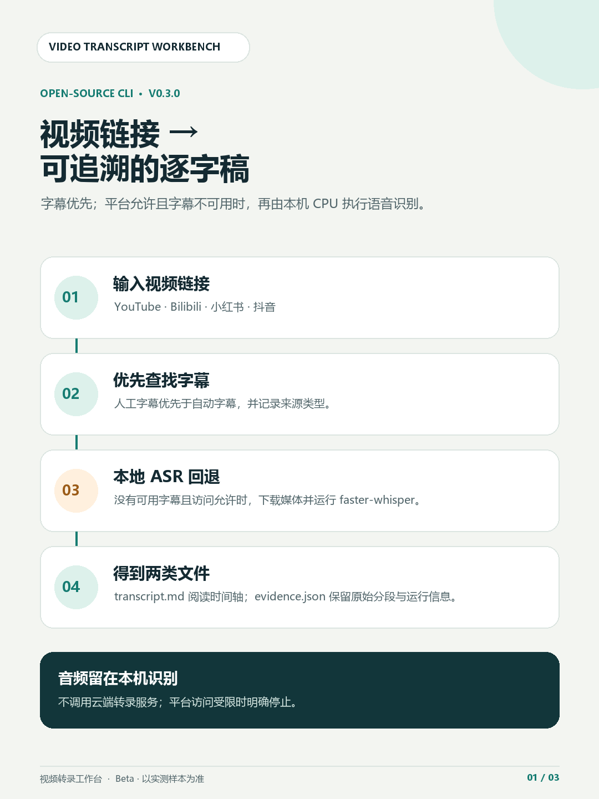
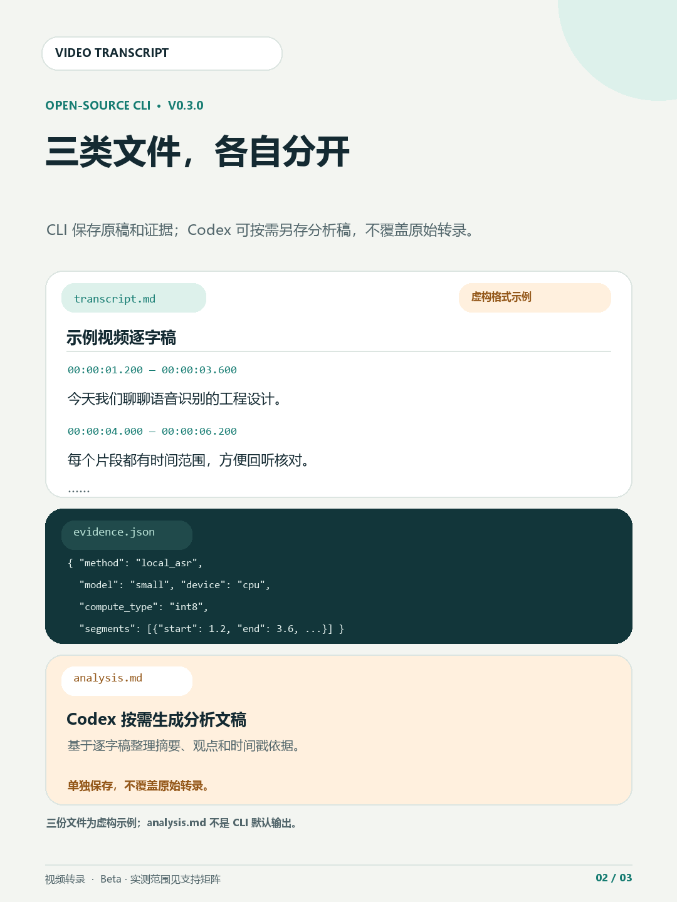
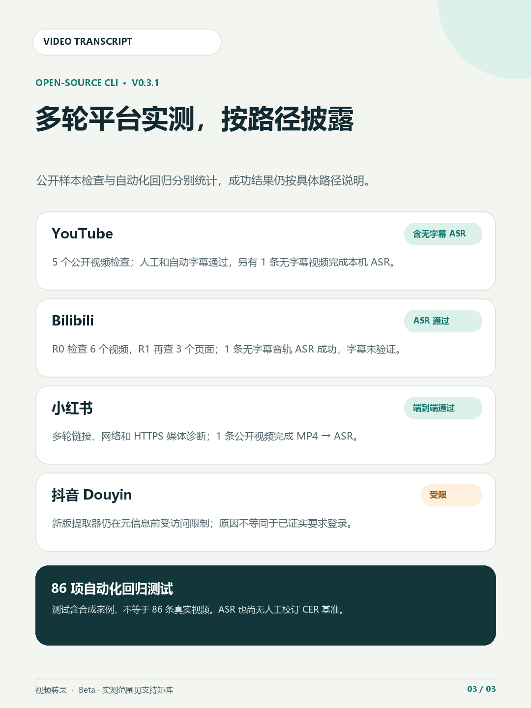

# Video Transcript Workbench

**在线 CLI Beta v0.3.0 · 中文说明** 
[English](README.en.md) · [在线平台实测矩阵](docs/online-support-matrix.md)

Video Transcript Workbench 是一个以在线视频链接为入口的逐字稿命令行工具。它优先获取可用字幕；在字幕不可用、平台允许访问且本机资源满足条件时，才下载媒体并使用本地 CPU 语音识别。转录结果保存为带时间轴的 Markdown 和可追溯的 `evidence.json`。

> 这是一个有真实样本验收的 Beta，不代表所有视频或所有网络环境都能处理成功。当前只对支持矩阵中标明 PASS 的具体路径作出实测声明。

## 项目是什么？怎么使用？

这是一个可以独立运行的 Python 命令行工具（CLI），不是 Agent Skill，也不要求先安装或打开 AI Agent。字幕选择、媒体获取和本地 ASR 都由 CLI 执行。

**独立使用**：安装项目和本地 Whisper 模型后，在 PowerShell 运行命令：

~~~powershell
video-transcript-link "https://www.youtube.com/watch?v=VIDEO_ID" --language zh --model small --output-dir "D:\transcripts\run-01"
~~~

转录完成后查看输出目录中的 transcript.md 和 evidence.json。平台实测范围见[在线平台实测矩阵](docs/online-support-matrix.md)。

**搭配 Codex 或 WorkBuddy**：如果 Agent 运行在本机，并且它能访问安装了本项目的 Python 环境、媒体文件和模型缓存，就可以让它代为组织参数、运行 CLI 并检查结果。Codex 的本地项目以你选定的目录为工作上下文；WorkBuddy 等工具也需要满足本机命令执行和文件访问条件。若 Agent 运行在云端或另一台机器，它不会自动拥有这台电脑上的文件、代理或模型。

当前仓库没有提供可安装的 Agent Skill。以后可以另做一个 Skill 作为调用说明和参数模板，底层仍由这个 CLI 完成转录。为了保护内容隐私，如果让云端 Agent 阅读或总结逐字稿，文本可能会进入该 Agent 的模型处理流程；只想本机转录时，直接运行 CLI 即可。

## 处理流程

流程简述：

1. 输入 YouTube、Bilibili、抖音或小红书视频链接，或选择本地媒体文件。
2. 在线链接先查找匹配语言的人工字幕，再尝试自动字幕。
3. 没有可用字幕时，只有在平台正常允许访问的情况下，才获取音轨或带音轨 MP4，并在本机运行 faster-whisper CPU/int8。
4. 输出时间轴逐字稿 `transcript.md` 和原始分段、来源及运行参数 `evidence.json`。

字幕内容与 ASR 原始识别文本都会保留；格式化不会覆盖原始分段。工具不调用云端转录服务，不读取浏览器 Cookie，也不绕过登录、真人验证或地区限制。

## 输出效果示意

上图中的标题、逐字稿和 JSON 均为**虚构格式示例**，用于展示文件结构，不是实际用户视频内容，也不代表识别准确率。

## 在线平台实测状态

| 平台与路径 | 实测状态 | 说明 |
|---|---|---|
| YouTube 人工字幕 | PASS | 已真实获取字幕；特定字幕格式失败时验证过备用字幕格式。 |
| YouTube 自动字幕 | PASS | 已真实获取自动字幕，证据中保留其自动生成属性。 |
| YouTube 无字幕音频回退 | 受限 | 测试环境遇到平台访问验证，程序不会绕过。 |
| Bilibili 无字幕音轨 → 本地 ASR | PASS | 已完成真实音轨下载和 CPU 转录。 |
| Bilibili 字幕获取 | 未验证 | 尚无真实字幕成功样本。 |
| 小红书 HTTPS MP4 → 本地 ASR | PASS（单样本） | 一条公开视频完成真实下载与本地转录；不代表其他视频都能访问。 |
| 小红书字幕获取 | 未验证 | 尚无成功解析真实字幕轨道的样本。 |
| 抖音在线转录 | 受限 | 实测遇到 fresh-cookie challenge，未完成在线端到端转录；工具不会读取或获取凭据。 |

详细样本、状态定义和用户可见限制见[在线平台实测矩阵](docs/online-support-matrix.md)。**目前没有人工校订参考稿 CER 基准，因此不声称模型准确率排名或普遍准确率。**

## 命令

安装后提供三个入口：

- `video-transcript-link`：在线链接，字幕优先；符合条件时回退到本地 CPU ASR。
- `video-transcript-online`：只获取在线字幕，不下载媒体、不运行 ASR。
- `video-transcript`：转录本地 WAV、MP3、M4A、MP4、WebM、Ogg 或 Opus 文件。

## Windows 安装

已验证环境为 Windows 10/11、Python 3.11。项目声明 Python 3.10+，其他版本和操作系统尚未完成验证。

~~~powershell
git clone https://github.com/CHAOSEA/video-transcript-workbench.git
cd video-transcript-workbench
py -3.11 -m venv .venv
.\.venv\Scripts\python.exe -m pip install --upgrade pip
.\.venv\Scripts\python.exe -m pip install .
.\.venv\Scripts\python.exe -m pip check
~~~

在线 YouTube JavaScript challenge 支持需要 Node.js。Node 24.22.0 LTS 与 yt-dlp-ejs 0.8.0 已完成隔离环境检查；EJS 要求 Node.js 22 或更新版本。Node.js 不由本项目安装。

Whisper 模型权重需要单独取得，本项目不会静默下载或自动切换模型。已验收的模型为 `Systran/faster-whisper-small`。如果本机尚无该模型，可在明确选择后使用 Hugging Face Hub 工具下载，例如：

~~~powershell
hf download Systran/faster-whisper-small
~~~

模型文件不包含在 Python 安装包中，需遵循其自身许可证和使用条款。

## 在线链接用法

### 字幕优先，必要时本地 ASR

~~~powershell
video-transcript-link "https://www.youtube.com/watch?v=VIDEO_ID" --language zh --model small --output-dir "D:\transcripts\video-run-01"
~~~

支持 YouTube、Bilibili、抖音和小红书视频笔记 URL。字幕语言偏好为 `zh`、`en`、`ja`。小红书仅支持视频笔记，不支持纯图文笔记。

链接可识别不等于每个链接都能处理。访问权限、字幕轨道、地区、网络、媒体格式和本地资源都会影响结果；请先查看上面的样本级实测矩阵。

### 只获取字幕

~~~powershell
video-transcript-online "https://www.youtube.com/watch?v=VIDEO_ID" --language en --output-dir "D:\transcripts\subtitle-run-01"
~~~

该命令只获取平台元信息和匹配字幕，不下载媒体，也不运行语音识别。

## 本地媒体用法

~~~powershell
video-transcript "D:\media\sample.mp4" --model small --language zh --output-dir "D:\transcripts\local-run-01"
~~~

媒体在本机解码和转录。视频输入使用第一条音轨，源文件不会被修改。模型必须是本地已有的模型路径或已缓存模型；缺失时会报错，不会静默下载或降级。

## 结果与隐私

成功运行会生成：

- `transcript.md`：逐段时间轴与原始文字。
- `evidence.json`：视频标识或本地输入 SHA256、字幕/ASR 来源、原始分段、模型与设备参数、依赖版本及运行状态。

在线证据不会保存原始查询参数、签名字幕地址或签名媒体地址。小红书分享链接中显式提供的必要分享参数只在请求期间使用，不写入证据或安全错误。结果文件本身可能包含视频标题和完整逐字稿，请妥善保管输出目录。

工具不使用云端 ASR，不自动读取浏览器资料或 Cookie，不绕过访问验证。线上下载有时长和字节数限制，媒体使用临时目录并在流程结束后清理。CPU 解码较长视频可能占用较多内存。

## 已知限制

- 平台访问检查、网络或代理故障会作为独立失败状态报告，不会被伪装成“没有字幕”。
- 用户指定的模型不会自动降级；模型文件缺失会明确报错。
- ASR 尚无人工参考稿 CER 对照，较大模型不等于已证明更准确。
- 成功样本不保证其他视频、语言、地区或网络环境可以成功。
- 仅处理自己有权访问和处理的媒体，并遵循平台条款和内容权利要求。

## 开发与测试

维护者的 v0.3.0 发布验收在 Windows Python 3.11 环境通过了 **86 项自动化测试**。测试包含合成媒体与字幕样例，不替代真实平台兼容性验证。

~~~powershell
python -m unittest discover -s tests -v
~~~

Node.js 24 LTS / yt-dlp-ejs、完整依赖安装和发行包检查记录见[依赖与权利记录](DEPENDENCIES.md)。

## 许可证

项目源码采用 MIT 许可证，版权行：`Copyright (c) 2026 CHAOS`。完整许可见 [LICENSE](LICENSE)。依赖、模型文件、以及处理的视频、音频和字幕仍各自遵循其许可证和平台条款。
